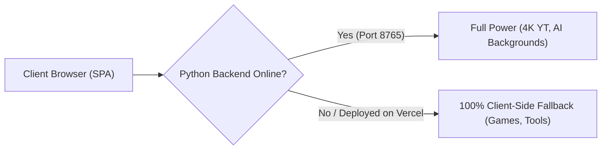

# System Architecture & Directory Taxonomy

## 1. Technology Matrix

| Layer / Domain | Technology | Purpose & Key Details |
|---|---|---|
| **Frontend Framework** | **Angular 22** (`@angular/core`) | Zoneless Change Detection (`provideBrowserGlobalErrorListeners`), Signals (`signal`, `computed`, `effect`), Standalone Components, Modern Control Flow (`@if`, `@for`, `@switch`) |
| **Language & Typings** | **TypeScript 6.0+** | Strict typing, zero `any` policy where practical |
| **Styling & Theming** | **CSS3 Custom Properties** | Multi-theme system (`Nexus Glow`, `Apple HIG`, `Frontend UI`), Glassmorphism, backdrop filters, responsive mobile-first grid, zero external CSS dependencies |
| **Internationalization** | **Bilingual Signal Engine** | Native DE/EN runtime switching via `LanguageService` with dual localStorage synchronization (`allinone_global_lang` + legacy game keys) |
| **Client Utilities** | `qrcode` | QR-Code rendering on HTML5 Canvas & SVG export |
| **Testing Harness** | **Vitest 5.0+ & jsdom** | Ultra-fast unit testing runner (`npm test` executes Vitest across app & services) |
| **Local Companion Backend** | **Python 3.9+ (Flask + CORS)** | Local HTTP daemon on `http://127.0.0.1:8765/api` for compute-heavy OS and media tasks |
| **Media & AI Processing** | `yt-dlp`, `pytubefix`, `imageio-ffmpeg`, `rembg`, `onnxruntime`, `opencv-python-headless`, `Pillow` | 4K video muxing, 320kbps MP3 extraction, U²-Net ONNX deep learning background removal, OpenCV GrabCut |
| **Deployment Target** | **Vercel** | Prebuilt static SPA deployed from `dist/AllInOne/browser` with wildcard rewrite rules in `vercel.json` |

---

## 2. Architectural Pattern

The project follows a **Hybrid Client-First Architecture with Graceful Degradation**:



### Layer Isolation & Invariant Rules:
1. **Zoneless Signal Reactivity:** Angular runs without `zone.js`. Asynchronous operations (such as `setInterval`, `requestAnimationFrame`, or DOM events) do not trigger change detection automatically. State must be updated via Angular Signals or explicitly marked via `ChangeDetectorRef.markForCheck()`.
2. **Zero-Cloud Client Fallback:** All party games, converters, QR studios, and password studios MUST execute 100% inside the browser sandbox (HTML5 Canvas, Web Audio API, Web Crypto API, `localStorage`). If the local Python backend is offline, the web portal operates without crashing.
3. **Synthetic Sound Guarantee:** Sound effects MUST NEVER depend on external MP3/WAV files. All buzzers, timer ticks, explosions, and melodies are synthesized on the fly via the native `AudioContext` Web Audio API.
4. **Central Catalog Authority:** Every page, tool, or game must be registered in `src/app/models/catalog.model.ts` to be indexed by the dashboard and spotlight carousel.
5. **Shared Player & Language State:** All party games must pull and synchronize player rosters from `src/app/services/player-storage.ts` and language preferences from `src/app/services/language.service.ts`.

---

## 3. Directory Taxonomy

| Directory Path | Architectural Responsibility | Key Files |
|---|---|---|
| `backend/` | Python companion daemon providing media and AI REST endpoints | `yt_downloader.py`, `bg_remover.py`, `requirements.txt` |
| `src/app/` | Angular application shell, routing, global navigation, and providers | `app.ts`, `app.html`, `app.css`, `app.spec.ts`, `app.routes.ts`, `app.config.ts` |
| `src/app/models/` | Central catalog, category definitions, and shared domain models | `catalog.model.ts` |
| `src/app/services/` | Singletons for theme management, language sync, player persistence, and backend HTTP bridges | `theme.service.ts`, `theme.service.spec.ts`, `language.service.ts`, `language.service.spec.ts`, `player-storage.ts`, `yt-downloader.service.ts`, `bg-remover.service.ts` |
| `src/app/pages/dashboard/` | Central hub with search, category filtering, and spotlight carousel | `dashboard.ts` |
| `src/app/pages/programs/` | Client and hybrid productivity tools (Universal Converter, QR Studio, Decision Hub, Password Studio, Dev Tools) | `universal-converter.ts`, `qr-studio.ts`, `decision-hub.ts`, `password-studio.ts`, `dev-tools.ts` |
| `src/app/pages/games/` | Digital board and party game suite (Tapple, Tabu, 5 Second Rule, Bombe, Anomia, Vollpfosten, Arcade games) | `tapple-game.ts`, `tabu-game.ts`, `tabu-cards.ts`, `five-seconds-game.ts`, `tick-tack-bumm-game.ts`, `anomia-game.ts`, `vollpfosten-game.ts`, `snake-game.ts`, `tictactoe-game.ts`, `memory-game.ts` |
| `src/app/pages/yt-downloader/` | High-speed 4K YouTube download & audio extraction UI | `yt-downloader.ts` |
| `src/app/pages/bg-remover/` | AI vision image matting and background removal UI with interactive slider | `bg-remover.ts` |
| `src/styles/` | Global CSS styles, resets, glassmorphism utilities, and modular theme definitions | `styles.css`, `themes/theme-apple.css`, `themes/theme-frontend-ui.css` |
| `dist/` | Production build output and Vercel hosting artifacts | `dist/AllInOne/browser/`, `vercel.json` |

---

## 4. Environment & Build Setup

### Prerequisites
- Node.js 20+ & npm 11+
- Python 3.9+ (with `venv` in `backend/.venv`)
- FFmpeg (bundled via `imageio-ffmpeg` or system binary)

### Daily Development Commands
```bash
# Start frontend only (http://localhost:4200)
npm start

# Start local Python backend daemon (http://127.0.0.1:8765)
npm run backend

# Start both frontend and backend concurrently
npm run dev

# Run Vitest unit tests (3 test suites, 12 passing tests)
npm test

# Production build for Vercel
npm run build
```
