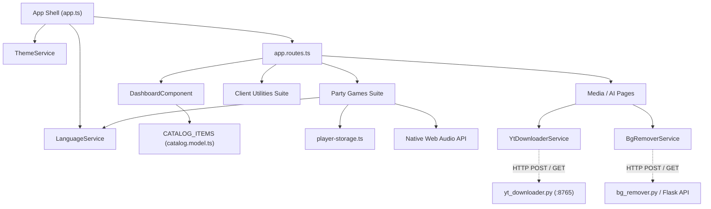

# Component & Module Catalog

## 1. Subsystems Overview

| Subsystem | Folder | Responsibility | Key Exports / APIs |
|---|---|---|---|
| **App Shell & Top Actions** | `src/app/` | Global layout, brand, responsive navbar, top-corner language & theme dropdowns, router outlet | `App`, `app.spec.ts`, `app.routes.ts`, `app.config.ts` |
| **Catalog Subsystem** | `src/app/models/` | Metadata registry for all tools and games | `CATALOG_ITEMS`, `CatalogItem`, `CategoryType` |
| **Theme Engine** | `src/app/services/` | Theme state management, DOM `data-theme` switching, local storage persistence | `ThemeService`, `THEME_OPTIONS`, `ThemeId` |
| **Language Engine** | `src/app/services/` | Global bilingual state (DE/EN), dual-key local storage persistence, DOM `lang` attribute | `LanguageService`, `LANGUAGE_OPTIONS`, `AppLanguage` |
| **Player Persistence** | `src/app/services/` | Shared player name roster synchronization across party games | `loadSavedPlayerNames()`, `savePlayerNames()` |
| **Media Downloader Client** | `src/app/services/` & `src/app/pages/yt-downloader/` | YouTube video metadata analysis, format selection, progress polling, Finder trigger | `YtDownloaderService`, `YtDownloaderComponent` |
| **AI Vision Client** | `src/app/services/` & `src/app/pages/bg-remover/` | AI & GrabCut image background removal, before/after split slider | `BgRemoverService`, `BgRemoverComponent` |
| **Party Games Suite** | `src/app/pages/games/` | Interactive digital board games: Tabu, Tapple, 5-Second-Rule, Tick Tack Bumm, Anomia, Vollpfosten, Snake, TicTacToe, Memory | Standalone components for each game (`TabuGameComponent`, `TappleGameComponent`, etc.) |
| **Client Utilities Suite** | `src/app/pages/programs/` | Client-side converters, QR studio, decision hub, password generator, dev tools | Standalone components (`UniversalConverterComponent`, `QrStudioComponent`, etc.) |
| **Python Companion Server** | `backend/` | Flask server hosting media processing pipelines, FFmpeg integration, and neural matting models | `backend/yt_downloader.py` (Port 8765), `backend/bg_remover.py` |

---

## 2. Inter-Component Dependency Matrix

- **ThemeService:** Injected into `App` component; modifies `document.documentElement` and `document.body` attributes (`data-theme`).
- **LanguageService:** Injected into `App` shell and party games (`TappleGameComponent`, `AnomiaGameComponent`, `FiveSecondsGameComponent`, `TickTackBummGameComponent`, `VollpfostenGameComponent`); synchronizes `currentLang` signal.
- **Player Storage:** Pure helper functions (`loadSavedPlayerNames`, `savePlayerNames`) consumed by party games.
- **Media Services:** Utilize Angular's `HttpClient` to communicate with the local server at `http://127.0.0.1:8765/api`.

---

## 3. External Integrations & Browser APIs

| Integration / API | Protocol / Scope | Key Files | Usage |
|---|---|---|---|
| **Local Python REST API** | HTTP / JSON & Multipart (`127.0.0.1:8765`) | `backend/yt_downloader.py`, `src/app/services/*` | Video download, FFmpeg merge, rembg background removal |
| **Web Audio API** | Native Browser API | `src/app/pages/games/*`, `src/app/pages/programs/*` | Procedural sound generation for buzzer, ticks, explosions, wheel clicks, and morse code |
| **Web Crypto API** | Native Browser API | `src/app/pages/programs/password-studio.ts` | Cryptographically secure random bytes (`crypto.getRandomValues`) and SHA-256 digests (`crypto.subtle.digest`) |
| **HTML5 Canvas** | Native Browser API | `snake-game.ts`, `decision-hub.ts`, `universal-converter.ts` | 60 FPS rendering, spinning wheel physics, image conversions |
| **LocalStorage API** | Browser Key-Value Store | `player-storage.ts`, `theme.service.ts`, `language.service.ts`, `tabu-game.ts` | Storing players (`allinone_party_players`), theme (`allinone_active_theme`), languages (`allinone_global_lang`, `allinone_tapple_lang`), and used cards |
| **QR Code Engine** | NPM package `qrcode` | `src/app/pages/programs/qr-studio.ts` | Generating matrix codes for Wi-Fi access cards and vCards |
