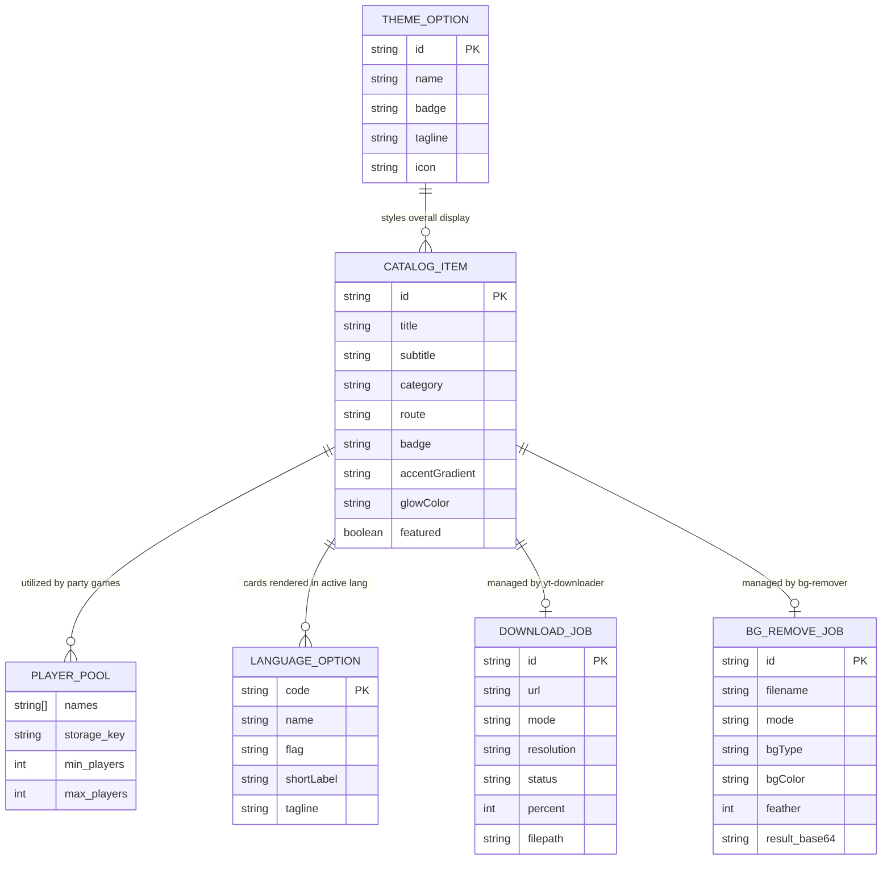

# Domain Concepts & Terminology

## 1. Ubiquitous Language (Glossary)

| Term | Meaning in this Project | Aliases / What it is NOT |
|---|---|---|
| **CatalogItem** | A registered application or game card rendered in the dashboard and spotlight carousel | Not an arbitrary route or component |
| **Player Pool** | Global list of participant names (2 to 8 players) shared and synchronized across party games | Not an auth account or user profile |
| **Language System** | Global reactive language state (`de` vs `en`) synchronized across all party games via `LanguageService` | Not a heavy i18n library (e.g. ngx-translate) |
| **Zoneless Signal** | Reactive state managed via Angular `signal()`, `computed()`, or `effect()` without Zone.js interception | Not a RxJS Subject or MobX observable |
| **Theme System** | Runtime theme state (`Nexus Glow`, `Apple HIG`, `Frontend UI`) driving `data-theme` and CSS custom variables | Not a static light/dark mode switch |
| **Synthetic Audio** | Procedural sound generation via the Web Audio API (`AudioContext`, `OscillatorNode`, `GainNode`) | Not an audio file (`.mp3` or `.wav`) |
| **GrabCut** | Foreground-background segmentation algorithm powered by OpenCV | Not a neural network model |
| **U²-Net** | Deep neural network running via ONNX runtime for AI salient object extraction (`rembg`) | Not a cloud API |
| **Tabu 3D-Faltbrett** | 36-space interactive board game circuit featuring squeaker, hourglass, and special cards | Not a generic score list |
| **Tapple Wheel** | 26-letter circular alphabet layout with countdown buzzer and category cards | Not a generic wheel of fortune |
| **Graceful Degradation** | Ability of the web client to function normally even if the local Python server is unreachable | Not an offline PWA mode |

---

## 2. Core Entities & Relationships

---

## 3. Business Invariants & Rules

1. **Player Pool Integrity:**
   - The player roster must contain at least 2 and at most 8 active player names.
   - Any update to a player's name in one game must persist immediately to `localStorage` under `allinone_party_players` so that subsequent games load the modified roster.
2. **Global Language Synchronization:**
   - When the user toggles language (`de` ↔ `en`) in any party game (Tapple, Anomia, 5-Second-Rule, Tick Tack Bumm, Stadt Land Vollpfosten) or the header dropdown, `LanguageService` synchronizes both `allinone_global_lang` and all legacy game-specific storage keys (`allinone_tapple_lang`, etc.).
   - Setting language updates `document.documentElement.setAttribute('lang', lang)`.
3. **Catalog Exclusivity & Categorization:**
   - Every module must belong to either `'programs'` or `'games'` category.
   - Featured items (`featured: true`) are displayed in the hero spotlight carousel on the dashboard.
4. **Sound Guarantee:**
   - Under no circumstances should game logic crash if audio is muted or the browser's `AudioContext` is blocked by autoplay policies; all sound routines must fail silently within `try/catch` blocks.
5. **Backend Autonomy:**
   - Download jobs on the backend execute in independent daemon threads; status polling uses non-blocking HTTP requests.
   - Downloaded media files are stored strictly within the user's local directory (`~/Downloads/AllInOne_YT` and `~/Downloads/AllInOne_BG`).
6. **Theme Cohesion:**
   - Themes must set the `data-theme` attribute simultaneously on both `<html>` and `<body>`.
   - The user's active theme selection must persist across sessions via `allinone_active_theme`.
