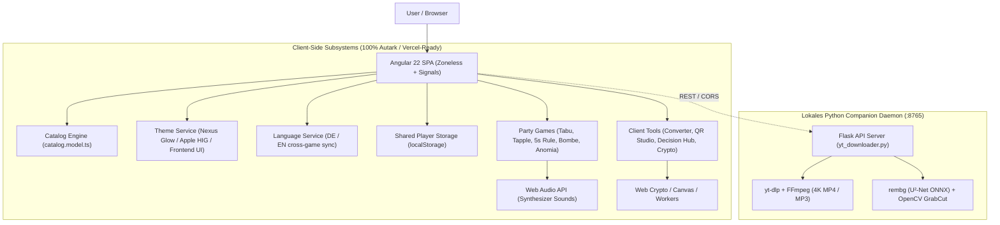

# Project Knowledge Map: AllInOne

> **Quick Summary:** AllInOne ist ein hybrides Web-Portal und Party-Hub, das autarke Angular 22 Client-Tools und -Spiele mit einem lokalen Python-Backend (Flask, FFmpeg, rembg AI) kombiniert.
> **Primary Tech Stack:** Angular 22 (Zoneless, Signals), TypeScript 6.0, Python 3.9+ (Flask, yt-dlp, rembg, OpenCV), Vitest, Vercel SPA
> **Last Updated:** 2026-11-10 | **Status:** Active / Multi-Themed & Bilingual

---

## Quick Navigation Index (When to read what)
| File | Topic & Scope | When an LLM should consult this |
|---|---|---|
| [`architecture.md`](./architecture.md) | High-level topology, stack, directory layout | Planning new features, understanding system layers |
| [`domain.md`](./domain.md) | Business concepts, entities, glossary | Working on business logic, schema changes, naming |
| [`components.md`](./components.md) | Subsystems, modules, key contracts & APIs | Editing specific services, adding endpoints or interfaces |
| [`workflows.md`](./workflows.md) | End-to-end data flows & lifecycles | Debugging data issues, tracing requests or background jobs |
| [`conventions.md`](./conventions.md) | Hard rules, gotchas, ADRs, pitfalls | Before modifying code to prevent breaking known constraints |

---

## Core Entry Points & Key Files
- **Frontend Bootstrap:** `src/main.ts` & `src/app/app.ts` (Root Component & Navbar)
- **Application Config & Routing:** `src/app/app.config.ts` & `src/app/app.routes.ts`
- **Central Catalog (Single Source of Truth):** `src/app/models/catalog.model.ts`
- **Mode Switcher (Spiele / Notebook):** `src/app/services/mode.service.ts`
- **Python Backend Daemon (Port 8765):** `backend/yt_downloader.py` & `backend/bg_remover.py`
- **Theme Engine:** `src/app/services/theme.service.ts` & `src/styles/themes/`
- **Language Engine (DE/EN):** `src/app/services/language.service.ts`
- **Shared Player Pool:** `src/app/services/player-storage.ts`
- **Global Design System (Unslop):** `src/styles.css` & `src/app/app.css`

---

## High-Level Topology

