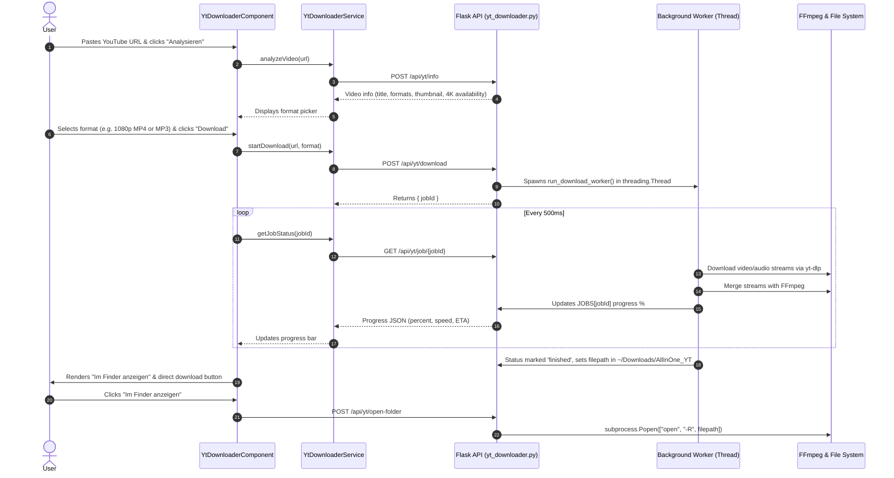
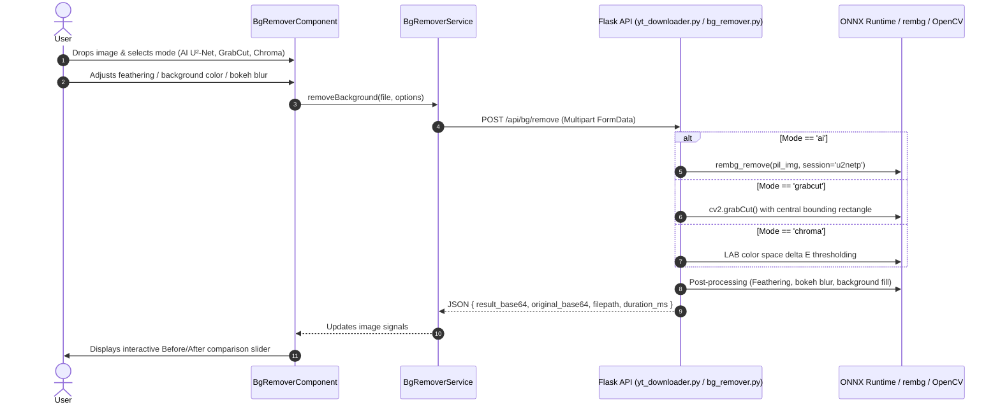
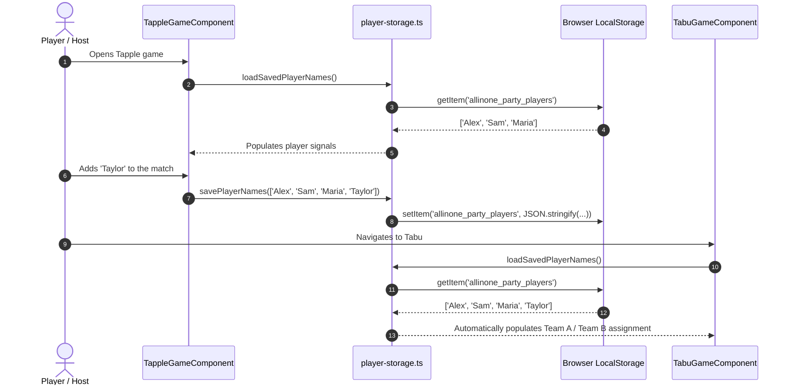
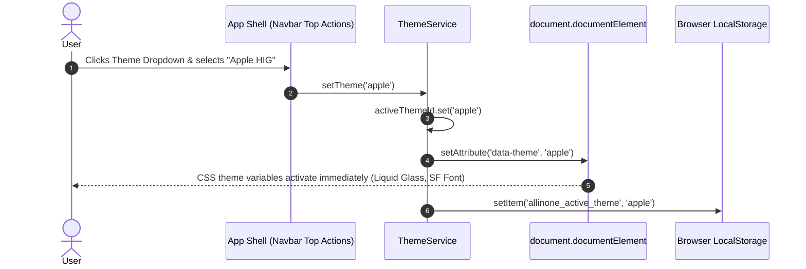
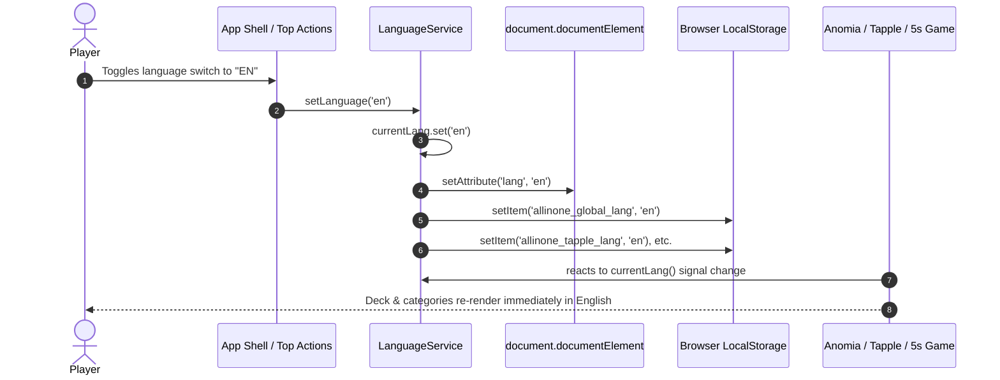

# Workflows & Execution Lifecycles

## 1. Core End-to-End Lifecycles

### Workflow A: YouTube Video & Audio Download Flow

---

### Workflow B: AI Background Removal Flow

---

### Workflow C: Party Game Player Synchronization Flow

---

### Workflow D: Dynamic Theme Switching Flow

---

### Workflow E: Bilingual Language Switching & Cross-Game Sync Flow

---

## 2. Asynchronous & Background Job Management

### Python Thread Synchronization
- Download workers are spun off using standard Python `threading.Thread(target=run_download_worker, ...)` to ensure the Flask main event loop is never blocked during long-running 4K video downloads.
- State access across threads is protected via `JOBS_LOCK = threading.Lock()`.
- Jobs remain addressable by UUID for subsequent status polling and Finder reveal actions.
