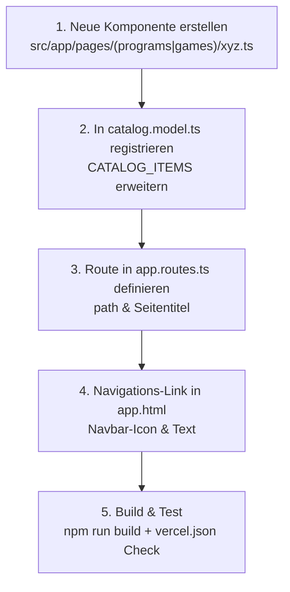

# 🚀 AllInOne — Master-Architektur, Codebase-Übersicht & LLM-Entwickler-Handbuch

> **Zweck dieses Dokuments:** Dieses Dokument ist als allumfassendes Nachschlagewerk und als **System-Prompt / Kontext für andere LLMs** (GPT-4, Claude 3.5 Sonnet, Gemini Pro, DeepSeek etc.) konzipiert. Jedes KI-Modell kann dieses Dokument einlesen und sofort ohne Rückfragen neue Spiele, Programme, UI-Komponenten oder Backend-Routen nahtlos und fehlerfrei in das bestehende System integrieren.

---

## 📑 Inhaltsverzeichnis
1. [Projekt-Steckbrief & Kernphilosophie](#1-projekt-steckbrief--kernphilosophie)
2. [Technologie-Stack & Systemvoraussetzungen](#2-technologie-stack--systemvoraussetzungen)
3. [Vollständige Projekt- & Ordnerstruktur](#3-vollständige-projekt--ordnerstruktur)
4. [Übersicht aller bestehenden Programme & Spiele](#4-übersicht-aller-bestehenden-programme--spiele)
5. [Die 5 kritischen Architektur-Regeln (Zoneless, Signals, Sound, Storage, Vercel)](#5-die-5-kritischen-architektur-regeln)
6. [Design-System, CSS-Variablen & Glasmorphismus](#6-design-system-css-variablen--glasmorphismus)
7. [Schritt-für-Schritt-Anleitung: Neues Spiel / Tool einbinden](#7-schritt-für-schritt-anleitung-neues-spiel--tool-einbinden)
8. [Copy & Paste Vorlagen für neue Module](#8-copy--paste-vorlagen-für-neue-module)
9. [Build-, Entwicklungs- & Deployment-Befehle](#9-build--entwicklungs--deployment-befehle)

---

## 1. Projekt-Steckbrief & Kernphilosophie

**AllInOne** ist ein modernes, multifunktionales Web-Portal und App-Hub. Es kombiniert:
1. **Lokale Hochleistungs-Utilities mit Python-Backend** (z. B. 4K YouTube-Downloader mit FFmpeg-Merge, KI-Hintergrundentfernung mit rembg / OpenCV).
2. **100 % Client-seitige Web-Tools** (Universal-Konverter für 30+ Formate, QR-Code & WLAN-Karten Generator, Entscheidungs-Hub mit Canvas-Glücksrad & 3D-Würfeln, Passwort-Studio, Dev-Tools).
3. **Digitale Party- & Brettspiele** (Tapple mit 26 Tasten, 5 Second Rule, Tick Tack Bumm mit Zufallsbombe, Anomia Duelle, Stadt Land Vollpfosten, Tabu mit 1.420+ Karten & 3D-Faltbrett, Neon Snake, Tic-Tac-Toe Minimax, Quantum Memory).

### Kernphilosophie:
- **Zero Cloud Friction:** Wo immer möglich, laufen Tools und Spiele komplett autark im Browser (HTML5 Canvas, Web Audio API, Web Crypto API, Web Workers).
- **Graceful Fallback:** Wenn das lokale Python-Backend nicht aktiv ist, funktionieren 95 % aller Features (alle Spiele & Browser-Tools) weiterhin uneingeschränkt auf Vercel.
- **Konsistente Spielernamen-Persistenz:** Spielernamen werden einmal eingegeben und über alle Partyspiele und Tools hinweg synchronisiert und in `localStorage` gemerkt.
- **Synthetisierter Sound:** Keine externen MP3-Dateien, die 404-Fehler werfen könnten – alle Buzzer, Klicks, Ticks und Bombenexplosionen werden live über die native Web Audio API synthetisiert.

---

## 2. Technologie-Stack & Systemvoraussetzungen

| Bereich | Technologie | Details / Version |
| :--- | :--- | :--- |
| **Frontend-Framework** | **Angular 22** (`@angular/core`) | **Zoneless** (ohne `zone.js`), Signals (`signal`, `computed`, `effect`), Control Flow (`@if`, `@for`, `@switch`) |
| **Sprache** | **TypeScript 6.0+** | Strikte Typisierung, Standalone Components (`standalone: true`) |
| **Build-Tool** | **Angular CLI / Vite / esbuild** | `ng build`, `npm run build` |
| **Styling** | **Mobiles & responsives CSS3** | Custom Properties, Glassmorphism, Backdrop-Filter, keine Third-Party UI-Libraries (Tailwind/Bootstrap nicht benötigt) |
| **Client-Libraries** | `qrcode` | QR-Code Rendering im Canvas / SVG |
| **Backend-Engine** | **Python 3.9+ (Flask + CORS)** | Lokaler REST-Server auf Port `8765` (`http://127.0.0.1:8765/api`) |
| **Python-Pakete** | `yt-dlp`, `pytubefix`, `rembg`, `onnxruntime`, `opencv-python-headless`, `Pillow`, `imageio-ffmpeg` | Video/Audio Processing, AI Background Removal |
| **Deployment** | **Vercel** | Prebuilt SPA-Deployment aus `dist/AllInOne/browser` mit `vercel.json` Rewrites |

---

## 3. Vollständige Projekt- & Ordnerstruktur

```text
AllInOne/
├── PROJECT_OVERVIEW.md             # Dieses Handbuch im Projektstamm (Markdown)
├── PROJECT_OVERVIEW.txt            # Leicht exportierbares Textdokument für andere LLMs
├── angular.json                    # Angular CLI Projekt-Konfiguration
├── package.json                    # Node Dependencies & Skripte
├── tsconfig.json                   # TypeScript Compiler-Konfiguration
├── dist/                           # Build-Ausgabeordner (wird auf Vercel deployt)
│   └── AllInOne/
│       └── browser/
│           ├── index.html
│           ├── vercel.json         # SPA-Rewrites für Vercel Deep-Links
│           └── ... (gebündelte Assets & JS)
├── backend/                        # Lokales Python-Backend
│   ├── .venv/                      # Virtuelle Python-Umgebung
│   ├── requirements.txt            # Python Dependencies
│   ├── yt_downloader.py            # Flask API-Server (Port 8765) & YT-Downloader-Logik
│   └── bg_remover.py               # AI & GrabCut Bildfreistellungs-Logik
└── src/
    ├── index.html                  # HTML-Einstiegspunkt
    ├── main.ts                     # Angular Bootstrap (provideZonelessChangeDetection)
    ├── styles.css                  # Globale CSS-Variablen, Themes, Glass-Klassen & Scrollbars
    └── app/
        ├── app.ts                  # Root Component (App Shell)
        ├── app.html                # Ambient Background Orbs & Sticky Navbar
        ├── app.css                 # Navbar-Layout & mobile Navigation
        ├── app.routes.ts           # Alle App-Routen mit Seitentiteln
        ├── app.config.ts           # AppConfig (HttpClient, Router)
        ├── models/
        │   └── catalog.model.ts    # ZENTRALER KATALOG: Metadaten aller Tools & Spiele
        ├── services/
        │   ├── player-storage.ts   # ZENTRAL: Speicherung & Sync der Spielernamen im localStorage
        │   ├── yt-downloader.service.ts # REST-Client für Python YouTube-Backend
        │   └── bg-remover.service.ts    # REST-Client für Python Background-Remover
        └── pages/
            ├── dashboard/
            │   └── dashboard.ts    # Startseite: Spotlight-Karussell, Filter, Suche, Grid
            ├── yt-downloader/
            │   └── yt-downloader.ts # YouTube Video/Audio 4K Downloader UI
            ├── bg-remover/
            │   └── bg-remover.ts   # KI & GrabCut Bildfreisteller UI (Vorher/Nachher-Slider)
            ├── programs/
            │   ├── universal-converter.ts # 30+ Formate: Bilder, Audio/Video, JSON/CSV/SQL, Einheiten
            │   ├── qr-studio.ts           # QR-Codes, druckbare WLAN-Karten, vCards, Logos
            │   ├── decision-hub.ts        # Canvas-Glücksrad, Team-Generator, 3D-Würfel, Münzwurf
            │   ├── password-studio.ts     # Web Crypto Passwort-Generator, Entropie & Hashes
            │   └── dev-tools.ts           # JSON Formatter/Minifier, Base64 & URL Encoder
            └── games/
                ├── tapple-game.ts         # Tapple: 26 Buchstabentasten (A–Z), 10s Timer, 100 Karten
                ├── five-seconds-game.ts   # 5-Sekunden-Regel: 3D-Spiral-Timer, 105 Karten DE/EN
                ├── tick-tack-bumm-game.ts # Tick Tack Bumm: Zufallsbombe (10-60s), Silben-Würfel
                ├── anomia-game.ts         # Anomia: Symbol-Duelle, Kaskaden-Kettenreaktionen
                ├── vollpfosten-game.ts    # Stadt Land Vollpfosten: Zuruf-Kartenspiel, Jackpot
                ├── tabu-cards.ts          # 1.420+ Tabu-Karten (Allgemein & IT, Easy & Hard)
                ├── tabu-game.ts           # Tabu: Signal-basiert, 36-Felder 3D-Faltbrett, Quietscher
                ├── snake-game.ts          # Neon Snake Cybergrid (Canvas, 60 FPS)
                ├── tictactoe-game.ts      # Cyber Tic-Tac-Toe mit unbesiegbarer Minimax-KI
                └── memory-game.ts         # Quantum Memory Matrix mit 3D-Flip-Karten
```

---

## 4. Übersicht aller bestehenden Programme & Spiele

### A. Programme (Kategorie: `'programs'`)
1. **YouTube Downloader** (`/programs/yt-downloader`):
   - Lädt bis zu 4K (2160p, 1440p, 1080p) MP4-Videos oder MP3/M4A Audio via lokalem Python-Backend (`yt-dlp` / `pytubefix` + `FFmpeg`).
   - Live-Fortschrittsanzeige, Dateigrößenschätzung, automatisches Öffnen im Mac Finder.
2. **AI Background Remover** (`/programs/bg-remover`):
   - KI-Freistellung mit `rembg` (U²-Net ONNX) oder OpenCV GrabCut/Chroma-Key.
   - Live Vorher-/Nachher-Vergleichsslider, Bokeh-Weichzeichner, farbige Hintergründe.
3. **Universal Converter Studio** (`/programs/universal-converter`):
   - **Bilder:** Konvertiert Batch-Bilder zwischen PNG, JPEG, WebP, BMP, ICO, Base64 und exportiert mehrseitige PDFs.
   - **Audio/Video:** Extrahiert Tonspuren und konvertiert Audio/Video direkt via Web Audio API in WAV inkl. interaktivem Waveform-Trimmer.
   - **Daten:** Bidirektionaler Konverter zwischen JSON, CSV, TSV, XML, YAML, SQL INSERT und Markdown-Tabellen.
   - **Einheiten & Mathe:** 8 Kategorien (Länge, Masse, Temperatur, Datenvolumen etc.), Zahlensysteme (Binär, Hex, Oktal), Farbcode (HEX, RGB, HSL) und Morsecode mit Live-Audiowiedergabe.
4. **QR-Code & WLAN-Karten Studio** (`/programs/qr-studio`):
   - Generiert stylische QR-Codes mit Farbverläufen, runden Dots und Logo im Zentrum.
   - Erstellt druckfertige WLAN-Gastkarten (WPA/WPA2/WPA3), vCard 3.0, WhatsApp- & SMS-Links. Export als PNG oder SVG.
5. **Entscheidungs-Hub & Glücksrad** (`/programs/decision-hub`):
   - Physikbasiertes Wheel of Names auf HTML5 Canvas mit Zeiger-Ticker und Konfetti.
   - Team-Generator & 1v1 Turnier-Bracket-Auslosung mit Kapitänen.
   - 3D-Würfel-Arena mit D4 bis D100, Hold-Funktion und Kniffel-Erkennung. 3D-Münzwurf & Orakel.
6. **Passwort & Crypto Studio** (`/programs/password-studio`):
   - Kryptografisch sichere Zufallspasswörter via `crypto.getRandomValues`.
   - Entropie-Berechnung, Knackzeit-Schätzung und SHA-256 Hash-Rechner.
7. **Dev Tools & JSON Lab** (`/programs/dev-tools`):
   - JSON Pretty-Print & Minifier mit Syntax-Fehleranzeige, Base64 Encoder/Decoder, URL-Encoder.

### B. Spiele (Kategorie: `'games'`)
1. **Tapple — Das Wort-Rad** (`/games/tapple`):
   - Echtes Tapple-Rad mit allen **26 Buchstaben von A bis Z** (360° / 26 = 13.85° Kreisaufteilung).
   - 10-Sekunden-Timer mit Buzzer-Knopf, Tick-Sound und Alarm.
   - **100 beidseitige Karten = 200 zweisprachige Kategorien (DE & EN)**.
2. **5 Second Rule (5-Sekunden-Regel)** (`/games/five-seconds`):
   - Nenne 3 Begriffe in 5 Sekunden! Animierter 3D-Spiral-Kugeltimer.
   - **105 Fragenkarten (DE/EN)**, Weiterwandern-Regel, Wechseln- und Weitergeben-Spezialkarten.
3. **Tick Tack Bumm — Party Edition** (`/games/tick-tack-bumm`):
   - Unberechenbare Bombe tickt geheim zwischen 10 und 60 Sekunden und explodiert mit Sound & Wackeleffekt.
   - Spezialwürfel: *Tick* (Silbe am Anfang), *Tack* (Silbe am Ende), *Bombe* (Silbe überall).
   - **108 Karten** (65 Kategorien + 43 Silben).
4. **Anomia — Blitz-Duelle** (`/games/anomia`):
   - Spieler decken reihum Karten mit 6 geometrischen Symbolen auf. Stimmen zwei überein, entsteht ein Kopf-an-Kopf Zuruf-Duell.
   - Inklusive echter Kettenreaktionen (Kaskaden) und Joker-Karten. **108 Kategorien**.
5. **Stadt Land Vollpfosten — Das Kartenspiel** (`/games/vollpfosten`):
   - Stadt-Land-Fluss als Zurufspiel ohne Zettel.
   - 110 lustige Kategorien, Zufalls-Buchstabe, 4 Spezialmodi (Buchstabendreher, Doppelpack, Aussetzer, Jackpot).
6. **Tabu — Das Partyspiel** (`/games/tabu`):
   - **1.420+ Tabu-Karten** in `tabu-cards.ts`: Aufgeteilt in Kategorien (*Allgemein* & *IT/Tech*) sowie Schwierigkeiten (*Easy* & *Hard*).
   - **4+ Spieler in 2 Teams** (Team A & Team B): Voll synchronisiert mit `player-storage.ts` und eigener Team-Persistenz im `localStorage` (`allinone_tabu_teams`).
   - **36-Felder 3D-Faltbrett**: Start 🏁, Quietscher-Felder 🚨, Sanduhr-Felder ⏳, Spezial-Felder 🃏 (Doppelte Zeit, Doppelter Buzzer) und Farbkategorien c0–c3.
   - **Interaktiver Tabu-Quietscher**: Synthetisierter Synth-Sound via Web Audio API, Tastatur-Shortcuts (Space, Enter, Z, Q) und animierte Karten-Transitions.
   - **Tracking & Historie**: Bereits gespielte Karten werden in `localStorage` gemerkt (`allinone_tabu_used_cards`), sodass keine Wiederholungen auftreten.
7. **Neon Snake Cybergrid** (`/games/snake`):
   - 60 FPS HTML5 Canvas Arcade-Klassiker im Cyberpunk-Stil mit Highscore und 3 Geschwindigkeiten.
8. **Cyber Tic-Tac-Toe AI** (`/games/tictactoe`):
   - Unbesiegbarer Minimax-KI-Gegner oder lokaler 2-Spieler-Modus.
9. **Quantum Memory Matrix** (`/games/memory`):
   - 16 Quanten-Karten mit 3D-Flip-Animationen, Zugzähler und Stoppuhr.

---

## 5. Die 5 kritischen Architektur-Regeln

Jedes LLM, das Code für dieses Projekt schreibt, **MUSS** diese 5 Regeln befolgen:

### ⚠️ Regel 1: Angular 22 läuft ZONELESS (Kein `zone.js`) & Signal-First
Angular 22 läuft in diesem Projekt standardmäßig ohne `zone.js`. Das bedeutet:
- **Signals sind First-Class:** Verwende bevorzugt `signal()`, `computed()` und `effect()` für reaktiven State (wie in `tabu-game.ts`).
- **Asynchrone Callbacks triggern KEINE automatische Change Detection:** Wenn du `setInterval`, `setTimeout`, `requestAnimationFrame` oder native Event-Listener nutzt, um normale Variablen zu mutieren, **bekommt das Template nichts davon mit!**
- **Lösung:** Injiziere immer `ChangeDetectorRef` und rufe in Timer-Callbacks explizit `this.cdr.markForCheck()` auf, oder nutze Signals (`this.timeLeft.update(t => t - 1)`).

```typescript
// ✅ VARIANTE A: Signals (wie in Tabu)
readonly timeLeft = signal(60);
// Im Timer:
this.timeLeft.update(t => Math.max(0, t - 1));

// ✅ VARIANTE B: ChangeDetectorRef (bei klassischen Properties)
import { Component, ChangeDetectorRef, inject } from '@angular/core';

export class TimerGameComponent {
  private readonly cdr = inject(ChangeDetectorRef);
  timeLeft = 10;
  private timerId: any = null;

  startTimer(): void {
    clearInterval(this.timerId);
    this.timerId = setInterval(() => {
      if (this.timeLeft > 0) {
        this.timeLeft--;
        this.cdr.markForCheck(); // 👈 ESSENZIELL! Ohne das friert das UI ein!
      } else {
        clearInterval(this.timerId);
        this.onTimeExpired();
        this.cdr.markForCheck();
      }
    }, 1000);
  }
}
```

---

### ⚠️ Regel 2: Spielernamen immer über `player-storage.ts` synchronisieren
Alle Partyspiele teilen sich denselben Spielerpool über den Service `src/app/services/player-storage.ts`:

```typescript
import { loadSavedPlayerNames, savePlayerNames } from '../../services/player-storage';

// 1. Beim Initialisieren laden:
players: string[] = loadSavedPlayerNames(['Spieler 1', 'Spieler 2', 'Spieler 3']);

// 2. Bei JEDER Änderung (Hinzufügen, Entfernen, Umbenennen) speichern:
addPlayer(name: string): void {
  this.players.push(name.trim());
  savePlayerNames(this.players); // 👈 Speichert in localStorage ('allinone_party_players')
}

removePlayer(index: number): void {
  this.players.splice(index, 1);
  savePlayerNames(this.players);
}
```

---

### ⚠️ Regel 3: Sound-Effekte IMMER mit Web Audio API synthetisieren
Keine externen MP3/WAV-Dateien referenzieren! Browser blockieren oft Cross-Origin-Dateien oder sie fehlen im Build. Nutze diesen kompakten Audio-Synthesizer:

```typescript
private playTone(freq: number, type: OscillatorType, duration: number, gainVal = 0.15): void {
  try {
    const ctx = new (window.AudioContext || (window as any).webkitAudioContext)();
    const osc = ctx.createOscillator();
    const gain = ctx.createGain();
    osc.type = type;
    osc.frequency.setValueAtTime(freq, ctx.currentTime);
    gain.gain.setValueAtTime(gainVal, ctx.currentTime);
    gain.gain.exponentialRampToValueAtTime(0.0001, ctx.currentTime + duration);
    osc.connect(gain);
    gain.connect(ctx.destination);
    osc.start();
    osc.stop(ctx.currentTime + duration);
  } catch {}
}

// Typische Sound-Beispiele:
playTick() { this.playTone(800, 'sine', 0.05, 0.08); }
playBuzzer() { this.playTone(180, 'sawtooth', 0.45, 0.25); }
playSuccess() { this.playTone(587.33, 'triangle', 0.12); setTimeout(() => this.playTone(880, 'triangle', 0.3), 120); }
```

---

### ⚠️ Regel 4: Neuer Katalog-Eintrag in `catalog.model.ts`
Jedes Programm und jedes Spiel **MUSS** in `src/app/models/catalog.model.ts` in das `CATALOG_ITEMS`-Array eingetragen werden. Das Dashboard liest dieses Array aus und erzeugt automatisch:
- Den Eintrag im rotierenden Hero-Spotlight-Karussell.
- Die Such- und Filterbarkeit im Haupt-Dashboard.
- Die Badge-, Glow- und Gradient-Darstellung.

---

### ⚠️ Regel 5: Vercel SPA-Routing (`vercel.json`)
Da Angular eine Single Page Application (SPA) mit HTML5 PushState-Routing ist, würden direkte Aufrufe von Unterseiten wie `https://meine-seite.vercel.app/games/tapple` auf Vercel einen 404-Fehler werfen, wenn Vercel nicht weiß, dass alle Anfragen an `/index.html` weitergeleitet werden müssen.

Immer nach einem `npm run build` sicherstellen, dass in `dist/AllInOne/browser/vercel.json` folgendes steht:
```json
{
  "rewrites": [
    { "source": "/(.*)", "destination": "/index.html" }
  ]
}
```

---

## 6. Design-System, CSS-Variablen & Glasmorphismus

Das UI basiert auf einem modernen Dark-Mode Cyberpunk / Glassmorphism Design (`src/styles.css`):

### Globale CSS-Variablen:
```css
:root {
  --bg-primary: #07090e;              /* Tiefschwarzer Haupthintergrund */
  --bg-secondary: #0d111a;            /* Dunkelblauer Panel-Hintergrund */
  --bg-card: rgba(19, 25, 38, 0.72);  /* Halbtransparente Glaskarten */
  --bg-card-hover: rgba(26, 34, 52, 0.88);
  --border-subtle: rgba(255, 255, 255, 0.08);
  --border-highlight: rgba(255, 255, 255, 0.18);

  --text-primary: #f3f6fc;            /* Weißer Haupttext */
  --text-secondary: #9ba6be;          /* Gedimmter Subtext */
  --text-muted: #64708a;              /* Grauer Metatext */

  --accent-indigo: #6366f1;
  --accent-violet: #8b5cf6;
  --accent-cyan: #06b6d4;
  --accent-emerald: #10b981;
  --accent-rose: #f43f5e;
  --accent-amber: #f59e0b;

  --font-sans: 'Inter', -apple-system, BlinkMacSystemFont, sans-serif;
  --font-mono: 'JetBrains Mono', monospace;
}
```

### Standard-Klassen:
- `.glass-panel`: `background: var(--bg-card); backdrop-filter: blur(18px); border: 1px solid var(--border-subtle); border-radius: 20px;`
- `.btn-primary`: Farbverlaufs-Button mit Schwebeschatten (`transform: translateY(-2px);`).
- `.btn-secondary`: Transparenter Glas-Button mit hellem Hover-Rahmen.

---

## 7. Schritt-für-Schritt-Anleitung: Neues Spiel / Tool einbinden

Folge dieser **5-Schritte-Checkliste**, um ein neues Modul einzubauen:



### Schritt 1: Neue Komponente erstellen
Erstelle die Datei z. B. in `src/app/pages/games/mein-spiel.ts` oder `src/app/pages/programs/mein-tool.ts`.
- Standalone Component (`standalone: true`).
- Verwende Inline-Template und Inline-Styles für maximale Wartbarkeit.
- Verwende Signals oder `ChangeDetectorRef` für State & Timer.

### Schritt 2: In `catalog.model.ts` eintragen
Öffne `src/app/models/catalog.model.ts` und füge ein Objekt in `CATALOG_ITEMS` ein:
```typescript
{
  id: 'mein-spiel',
  title: 'Mein Spiel Titel',
  subtitle: 'Kurze prägnante Unterzeile',
  description: 'Detaillierte 2-Satz Beschreibung für das Dashboard.',
  category: 'games', // oder 'programs'
  categoryLabel: 'Spiel • Party & Taktik',
  icon: '🎲',
  route: '/games/mein-spiel',
  accentGradient: 'linear-gradient(135deg, #10b981 0%, #06b6d4 100%)',
  glowColor: 'rgba(16, 185, 129, 0.4)',
  badge: '🔥 2–6 Spieler',
  badgeType: 'featured',
  tags: ['Party', 'Würfel', 'Multiplayer'],
  highlights: [
    'Feature Highlight 1',
    'Feature Highlight 2',
    'Feature Highlight 3',
    'Feature Highlight 4',
  ],
  featured: true,
  statsLabel: '2–6 Spieler • Rundenbasiert',
}
```

### Schritt 3: In `app.routes.ts` verlinken
Öffne `src/app/app.routes.ts`:
```typescript
import { MeinSpielComponent } from './pages/games/mein-spiel';

export const routes: Routes = [
  // ... bestehende Routen ...
  {
    path: 'games/mein-spiel',
    component: MeinSpielComponent,
    title: 'Mein Spiel Titel — AllInOne',
  },
  { path: '**', redirectTo: '' },
];
```

### Schritt 4: In `app.html` in die Navigationsleiste aufnehmen
Öffne `src/app/app.html` und ergänze einen `<a>`-Link in `<nav class="nav-links">`:
```html
<a routerLink="/games/mein-spiel" routerLinkActive="active" class="nav-item">
  <span>🎲</span>
  <span>Mein Spiel</span>
</a>
```

### Schritt 5: Build prüfen & deployen
```bash
npm run build
echo '{"rewrites":[{"source":"/(.*)","destination":"/index.html"}]}' > dist/AllInOne/browser/vercel.json
npx vercel deploy dist/AllInOne/browser --prod
```

---

## 8. Copy & Paste Vorlagen für neue Module

### Vorlage A: Neues Partyspiel mit Spielernamen, Timer & Web Audio Sound
```typescript
import { Component, OnInit, OnDestroy, ChangeDetectorRef, inject } from '@angular/core';
import { CommonModule } from '@angular/common';
import { FormsModule } from '@angular/forms';
import { RouterLink } from '@angular/router';
import { loadSavedPlayerNames, savePlayerNames } from '../../services/player-storage';

@Component({
  selector: 'app-party-game-template',
  standalone: true,
  imports: [CommonModule, FormsModule, RouterLink],
  template: `
    <div class="game-container">
      <header class="header glass-panel">
        <div class="badge">🎲 PARTYSPIEL</div>
        <h1>Neues Partyspiel</h1>
        <p>Erklärung des Spielprinzips in einem kurzen Satz.</p>
      </header>

      <!-- SPIELER VERWALTUNG -->
      <section class="players-card glass-panel">
        <h3>👥 Spieler ({{ players.length }})</h3>
        <div class="player-chips">
          <span *ngFor="let p of players; let i = index" class="chip">
            {{ p }}
            <button (click)="removePlayer(i)" *ngIf="players.length > 2">×</button>
          </span>
        </div>
        <div class="add-player-row">
          <input [(ngModel)]="newPlayerName" (keyup.enter)="addPlayer()" placeholder="Neuer Spieler..." />
          <button (click)="addPlayer()" class="btn-secondary">+ Hinzufügen</button>
        </div>
      </section>

      <!-- SPIELFELD & TIMER -->
      <section class="arena-card glass-panel">
        <div class="timer-display" [class.urgent]="timeLeft <= 3">{{ timeLeft }}s</div>
        <div class="actions">
          <button (click)="startTimer()" class="btn-primary">▶ Runde starten</button>
          <button (click)="resetGame()" class="btn-secondary">↺ Zurücksetzen</button>
        </div>
      </section>
    </div>
  `,
  styles: [`
    .game-container { max-width: 900px; margin: 0 auto; padding: 1.5rem; display: flex; flex-direction: column; gap: 1.5rem; }
    .glass-panel { background: var(--bg-card); backdrop-filter: blur(16px); border: 1px solid var(--border-subtle); border-radius: 18px; padding: 1.5rem; }
    .badge { display: inline-block; padding: 0.25rem 0.65rem; border-radius: 999px; background: rgba(99, 102, 241, 0.2); color: #818cf8; font-size: 0.75rem; font-weight: 700; }
    .timer-display { font-size: 4rem; font-weight: 800; text-align: center; color: var(--accent-cyan); font-family: var(--font-mono); }
    .timer-display.urgent { color: var(--accent-rose); animation: pulse 0.5s infinite alternate; }
    .player-chips { display: flex; gap: 0.5rem; flex-wrap: wrap; margin-bottom: 1rem; }
    .chip { background: rgba(255, 255, 255, 0.08); padding: 0.4rem 0.8rem; border-radius: 999px; display: inline-flex; align-items: center; gap: 0.4rem; font-size: 0.85rem; }
    .chip button { background: none; border: none; color: #f43f5e; cursor: pointer; font-size: 1rem; }
    .add-player-row { display: flex; gap: 0.5rem; }
    .add-player-row input { flex: 1; background: rgba(0,0,0,0.3); border: 1px solid var(--border-subtle); border-radius: 10px; padding: 0.6rem 0.9rem; color: #fff; }
    .actions { display: flex; gap: 1rem; justify-content: center; margin-top: 1.5rem; }
    @keyframes pulse { from { transform: scale(1); } to { transform: scale(1.08); } }
  `]
})
export class PartyGameTemplateComponent implements OnInit, OnDestroy {
  private readonly cdr = inject(ChangeDetectorRef);

  players: string[] = [];
  newPlayerName = '';
  timeLeft = 10;
  private timerInterval: any = null;

  ngOnInit(): void {
    this.players = loadSavedPlayerNames(['Spieler 1', 'Spieler 2', 'Spieler 3']);
  }

  ngOnDestroy(): void {
    clearInterval(this.timerInterval);
  }

  addPlayer(): void {
    const trimmed = this.newPlayerName.trim();
    if (trimmed && !this.players.includes(trimmed)) {
      this.players.push(trimmed);
      this.newPlayerName = '';
      savePlayerNames(this.players);
    }
  }

  removePlayer(index: number): void {
    this.players.splice(index, 1);
    savePlayerNames(this.players);
  }

  startTimer(): void {
    clearInterval(this.timerInterval);
    this.timeLeft = 10;
    this.playSound(440, 'triangle', 0.1);
    this.timerInterval = setInterval(() => {
      if (this.timeLeft > 0) {
        this.timeLeft--;
        this.playSound(this.timeLeft <= 3 ? 880 : 440, 'sine', 0.05);
        this.cdr.markForCheck(); // WICHTIG FÜR ZONELESS!
      } else {
        clearInterval(this.timerInterval);
        this.playSound(200, 'sawtooth', 0.5);
        this.cdr.markForCheck();
      }
    }, 1000);
  }

  resetGame(): void {
    clearInterval(this.timerInterval);
    this.timeLeft = 10;
    this.cdr.markForCheck();
  }

  private playSound(freq: number, type: OscillatorType, dur: number): void {
    try {
      const ctx = new (window.AudioContext || (window as any).webkitAudioContext)();
      const osc = ctx.createOscillator();
      const gain = ctx.createGain();
      osc.type = type;
      osc.frequency.setValueAtTime(freq, ctx.currentTime);
      gain.gain.setValueAtTime(0.12, ctx.currentTime);
      gain.gain.exponentialRampToValueAtTime(0.001, ctx.currentTime + dur);
      osc.connect(gain);
      gain.connect(ctx.destination);
      osc.start();
      osc.stop(ctx.currentTime + dur);
    } catch {}
  }
}
```

---

## 9. Build-, Entwicklungs- & Deployment-Befehle

| Zweck | Befehl | Erklärung |
| :--- | :--- | :--- |
| **Lokales Frontend starten** | `npm start` | Startet Angular Dev-Server auf `http://localhost:4200` |
| **Lokales Python-Backend starten** | `npm run backend` | Startet Flask Server auf `http://127.0.0.1:8765` |
| **Frontend & Backend parallel** | `npm run dev` | Startet beides gleichzeitig in einer Shell |
| **Produktions-Build erstellen** | `npm run build` | Kompiliert das Projekt nach `dist/AllInOne/browser` |
| **Vercel Deep-Link Rewrite anlegen** | `echo '{"rewrites":[{"source":"/(.*)","destination":"/index.html"}]}' > dist/AllInOne/browser/vercel.json` | Verhindert 404-Fehler bei direktem Aufruf von Unterrouten |
| **Live auf Vercel deployen** | `npx vercel deploy dist/AllInOne/browser --prod` | Sofortige weltweite Aktualisierung auf Vercel |

---

> 💡 **Tipp für andere LLMs:** Wenn du gebeten wirst, ein neues Spiel oder Tool zu programmieren:
> 1. Erstelle die Komponente wie in Abschnitt 8 gezeigt.
> 2. Aktualisiere `src/app/models/catalog.model.ts`, `src/app/app.routes.ts` und `src/app/app.html`.
> 3. Achte peinlich genau auf **Angular 22 Zoneless** (`cdr.markForCheck()` in allen asynchronen Funktionen oder native Signals).
> 4. Speichere Spielernamen mit `savePlayerNames()`.
> 5. Nutze Web Audio für Sounds statt externer Assets.
